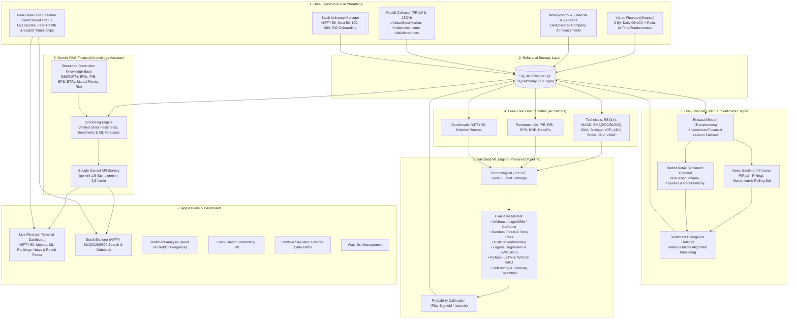

# SENTIMENT-APLHA
## AI-Powered Stock Market Sentiment Analysis, Prediction & Intelligent Investment Assistant

[](https://www.python.org/)
[](https://fastapi.tiangolo.com/)
[](https://react.dev/)
[](https://ai.google.dev/)
[](https://pytorch.org/)
[](LICENSE)

**SENTIMENT-APLHA** is a production-grade financial intelligence platform engineering quantitative equity modeling, multi-channel FinBERT sentiment analysis, Google Gemini-powered financial knowledge assistance, live market streaming, event-driven backtesting, and portfolio simulation across Indian capital markets (NSE NIFTY 50, NIFTY Next 50, NIFTY 100, 200, and 500).

---

## 1. System Architecture



---

## 2. Key Modules & Architectural Modifications

### A. Complete Removal of ML Lab UI (Backend Preserved)
- **Frontend Removal**: Completely removed `MLLabPage`, its navigation tab, and routes.
- **Backend Integrity Preserved**: All machine learning training, cross-validation, walk-forward splits, feature engineering, and inference pipelines (`backend/ml/`, `backend/features/`) remain fully functional. Stock predictions continue operating across all pages.

### B. Reddit Retail API Integration
- **Collector (`backend/collectors/reddit_collector.py`)**:
  - Connects via PRAW (with automatic public JSON and curated seeds fallback for offline/sandbox environments).
  - Monitors `r/IndianStockMarket`, `r/IndiaInvestments`, and `r/dalalstreetbets`.
  - Filters spam, Telegram pump-and-dump noise, and low-quality posts.
  - Matches stock symbols and Indian company aliases (`ALIAS_MAP`).
  - FinBERT sentiment integration evaluates retail discussions and stores scores in `SentimentRecord` (`source_type="reddit"`).
  - Updates `DailySentiment` with `reddit_sentiment` and `discussion_volume`.
- **Separation of Sentiments**: Financial news sentiment and Reddit retail sentiment are tracked, stored, and displayed **strictly separately**, with an automated **Divergence Metric** (`Reddit Sentiment - News Sentiment`) to highlight retail versus media disconnects.

### C. Google Gemini API — Financial Knowledge Assistant
- **Dedicated Service (`backend/rag/gemini_service.py`)**:
  - Direct, fast REST communication with Google Generative AI API (`gemini-1.5-flash` or `gemini-2.5-flash`).
  - Reads `GEMINI_API_KEY` and `GEMINI_MODEL` from environment variables without frontend exposure.
  - System instructions enforce strict senior quant analyst persona: cite sources and timestamps, distinguish historical facts from predictions, never invent figures, explain risks, and never guarantee investment returns.
- **Structured Knowledge Base (`backend/rag/knowledge_base.py`)**:
  - Covers stock market fundamentals, NSE & NIFTY 50 index calculations, IPOs (DRHP, anchor investors, retail quota), mutual funds vs. ETFs, P/E ratio, EPS, market cap categories, fundamental analysis (balance sheet, cash flow, ROE, ROCE), technical indicators (RSI, MACD, Bollinger Bands), risk management (stop-loss, position sizing, drawdown), and portfolio diversification.
- **Grounded RAG Pipeline (`backend/rag/assistant.py`)**:
  - Ingests database factsheets, live market prices, 10-day session trends, FinBERT news/Reddit scores, and ML prediction labels.
  - Graceful fallback engine guarantees factual, referenced responses even if external network access or API key is absent.

### D. Expanded Stock Universe (NIFTY 50, Next 50, 100, 200, 500)
- **`backend/collectors/stock_universe.py`**:
  - Dynamic catalog supporting NIFTY 50, NIFTY Next 50, NIFTY 100, NIFTY 200, and NIFTY 500 companies (e.g. Zomato, Jio Financial, HAL, BEL, Trent, Polycab, Dixon, Suzlon, Paytm).
  - **Dynamic Onboarding**: Users can search by ticker or company name. Selecting an un-onboarded company triggers on-demand price fetching, technical indicators generation, and prediction calibration.

### E. Real-Time / Near-Real-Time Streaming Service
- **`backend/services/market_updater.py`**:
  - Central broadcaster caching live market snapshots with explicit timestamp metadata.
  - WebSocket streaming endpoint at `/api/ws/market` (and `/ws/market`).
  - Server-Sent Events (SSE) streaming endpoint at `/api/stream/market`.
  - Snapshot endpoint at `/api/market/live-snapshot` with feed status (`STREAMING`, `NSE Near-Real-Time Feed`).
  - Transparent labeling: never mislabels delayed data as instantaneous real-time.

### F. Dashboard & Modern 8-Item Navigation
The UI provides an 8-page dark terminal layout (`#090d16` canvas, `#0f172a` cards, `#38bdf8` cyan, `#10b981` bullish green, `#f43f5e` bearish rose):
1. **Dashboard (`/`)**: Real-time NIFTY 50 performance, FinBERT market sentiment, News vs Reddit divergence gauge, top sentiment movers, ML prediction rankings, Reddit retail buzz, and latest financial news.
2. **Market Overview (`/market`)**: Market breadth, indices, top bullish/bearish setups, and system health status.
3. **Stock Explorer (`/stocks`)**: Search across NIFTY 50/100/200/500 stocks, dynamic ticker onboarding, multi-factor attribution, and interactive 90-day OHLCV charts.
4. **Sentiment Analysis (`/sentiment`)**: Side-by-side news vs Reddit comparison table, retail threads from r/IndianStockMarket, news feeds, and live interactive text classifier.
5. **AI Financial Assistant (`/assistant`)**: Conversational chat interface with Gemini API status indicator, starter prompt chips, grounded source citations, and compliance disclaimers.
6. **Backtesting (`/backtesting`)**: Event-driven backtester with capital constraints, slippage, brokerage fees, and equity curves.
7. **Portfolio Simulator (`/portfolio`)**: Multi-asset asset allocation and 500-run Monte Carlo probability cones (Expected, 95th, 5th percentiles).
8. **Watchlist (`/watchlist`)**: Dynamic target price tracking and custom investment notes.

---

## 3. Environment Variables & Configuration

Configure `.env` in the project root:

```ini
# Core Configuration
PROJECT_NAME="SENTIMENT-APLHA"
VERSION="2.0.0"
ENVIRONMENT="development"
API_PREFIX="/api"
PORT=8000
DATABASE_URL="sqlite:///./sentiment_alpha.db"

# FinBERT Sentiment Engine
FINBERT_OFFLINE=true
LIGHTWEIGHT_MODE=true

# Google Gemini API
GEMINI_API_KEY=""                # Insert Google Gemini API Key here
GEMINI_MODEL="gemini-1.5-flash"  # Supports gemini-1.5-flash, gemini-2.5-flash

# Reddit API Integration (PRAW)
REDDIT_CLIENT_ID=""              # Reddit Script App ID
REDDIT_CLIENT_SECRET=""          # Reddit Script App Secret
REDDIT_USER_AGENT="SentimentAlpha/1.0"
```

---

## 4. Quick Start & Execution

### Backend Setup & Test Suite
```powershell
# Activate Virtual Environment
.\backend\.venv\Scripts\Activate.ps1

# Run Full Test Suite (19 Passed Tests)
pytest tests/ -v

# Start FastAPI Backend Server with WebSocket & SSE Streaming
python -m uvicorn backend.main:app --host 0.0.0.0 --port 8000 --reload
```

### Frontend Setup & Build
```powershell
# Build Production Bundle (Vite + TypeScript)
npm --prefix frontend run build

# Start Frontend Development Server
npm --prefix frontend run dev
```

Interactive API documentation is accessible at `http://localhost:8000/docs`.

---

## 5. Verification & Test Coverage

All 19 automated tests pass with 0 failures:
- `tests/test_api.py`: Health, stocks, recommendations, RAG endpoints.
- `tests/test_modifications.py`: NIFTY 50/100/200/500 universe search, Reddit collector filtering/ticker extraction, financial curriculum knowledge base retrieval, Gemini API resilience, multi-topic RAG assistant queries, live market streaming snapshot, and sentiment comparison.
- `tests/test_features.py`: RSI, MACD, and Bollinger Bands calculation bounds.
- `tests/test_finbert.py`: FinBERT sentiment polarity classification.
- `tests/test_backtester.py`: Backtesting simulation with fees and slippage.
- `tests/test_rag.py`: Salary & savings calculations, and deep-dive stock analysis.
